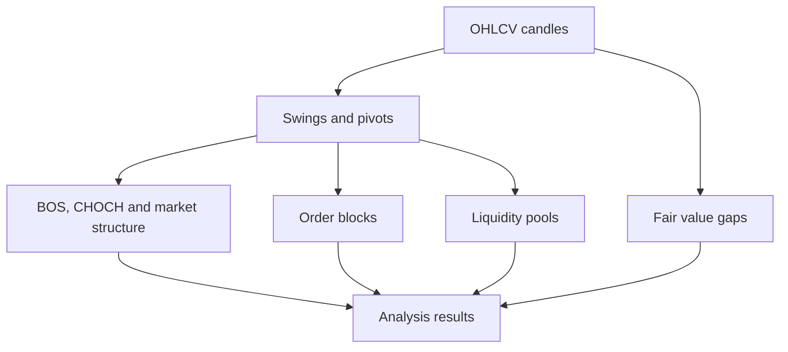

# SMC Market Structure Engine

A selected-code portfolio project drawn from my private Python trading bot. It covers detection of swing points, market structure, structural breaks, candidate order blocks, fair value gaps and liquidity levels.

The project is intentionally limited to the analysis layer. Trading execution, signal generation, risk/position sizing, proprietary filters, scoring parameters and full bot orchestration remain private.

[Read the engineering case study and historical-validation discussion](https://github.com/NFTPSYCHO5524/NFTPSYCHO5524/blob/main/projects/smc-market-structure-engine/README.md)

## Included modules

- `smc_analyzer.py` — curated standalone analysis functions
- `tests/test_analyzer.py` — small reproducible test suite
- `docs/ENGINEERING_NOTES.md` — timing assumptions, architecture boundaries and limitations
- `requirements.txt` — Python dependencies

## Quick start

```bash
git clone https://github.com/NFTPSYCHO5524/smc-market-structure-engine.git
cd smc-market-structure-engine
python -m venv .venv
source .venv/bin/activate
pip install -r requirements.txt
python -m pytest -q
```

On Windows use `.venv\\Scripts\\activate` to activate the environment.

The tests cover selected output contracts and one synthetic FVG detection. Passing them does not establish live-trading performance or all historical causality constraints.

## How the analysis fits together



**Important:** Pivot confirmation uses future candles relative to the pivot timestamp. Historical mitigation and sweep indices must not be used at zone formation time. This repository is not a ready-to-trade system.

## Usage

```python
import pandas as pd
from smc_analyzer import SMCAnalyzer

candles = pd.read_csv("candles.csv")  # requires open, high, low, close, volume
analyzer = SMCAnalyzer()
swings = analyzer.swing_highs_lows(candles, swing_length=5)
gaps = analyzer.fvg(candles)
print(swings.tail())
print(gaps.tail())
```

Use your own OHLCV data. No private trading records or credentials are distributed.

